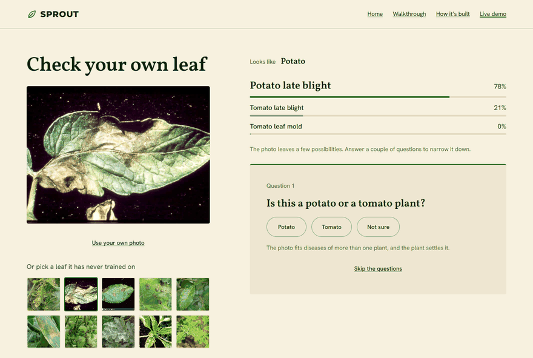
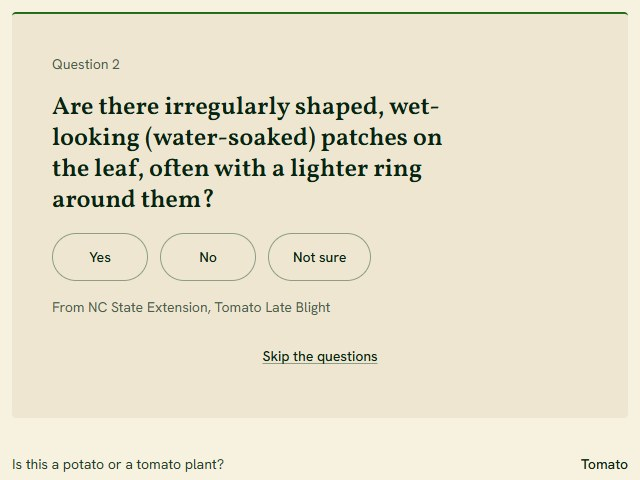
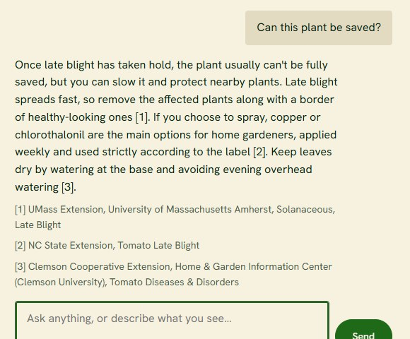
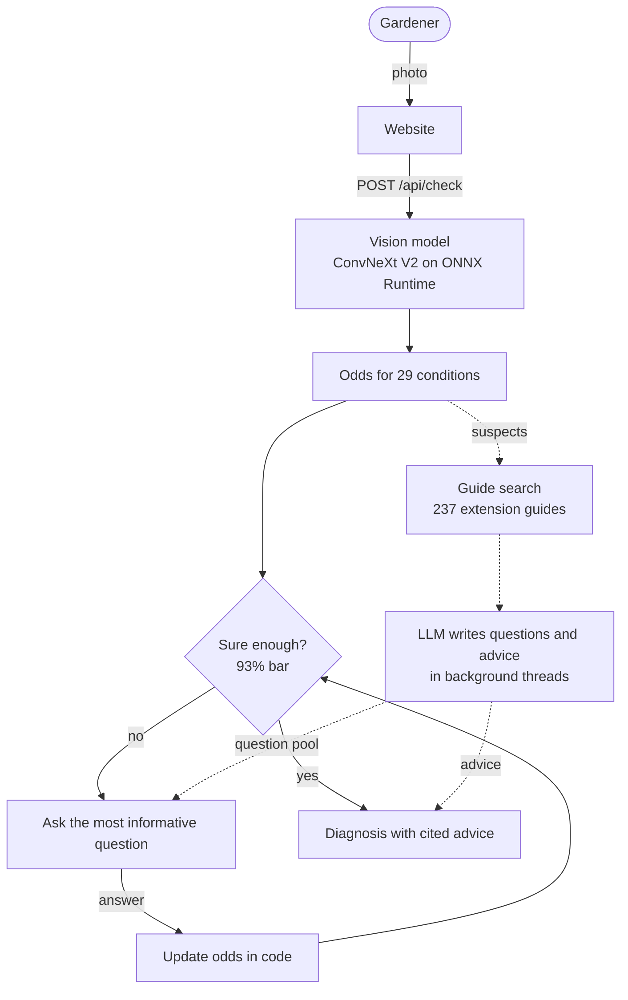

<div align="center">


# SPROUT

**Smart Plant Recovery and Optimization Utility Tool**

Photograph a sick leaf. SPROUT names the disease, asks the few questions that settle it, and tells you what to do, citing the university extension guide the advice came from.

     



<sub>A real run on a tomato leaf the model never trained on.</sub>

</div>

---

## Why it exists

The first version of SPROUT scored **99.8%** on lab photos of leaves on clean backgrounds. On real photos from gardens and fields it scored **24%**. A plant model that only works in the lab doesn't help anyone with a sick tomato.

So SPROUT was rebuilt around three ideas:

1. **Train for the real world.** The model learns from lab and field photos together, with near-duplicates kept out of the test set, and is scored on field photos it has never seen.
2. **Ask instead of guessing.** Look-alike diseases are hard to separate from one photo. SPROUT asks short yes or no questions about what you can see, written from extension guides, and stops as soon as it's sure.
3. **Show where advice comes from.** Every tip names the guide it came from. When no guide covers something, it says so.

## At a glance

<table>
<tr>
<td align="center" width="25%"><h2>96%</h2>right disease in the top three, from the photo alone</td>
<td align="center" width="25%"><h2>0.81</h2>macro-F1 on held-out field photos, up from 0.24</td>
<td align="center" width="25%"><h2>6.5 ms</h2>from a tap to the next question</td>
<td align="center" width="25%"><h2>237</h2>university extension guides behind every answer</td>
</tr>
</table>

## How a check works

<table>
<tr>
<td width="50%"></td>
<td width="50%"></td>
</tr>
<tr>
<td><b>1. The photo gives the odds.</b> A ConvNeXt V2 model scores 29 conditions across 14 plants in under half a second. If the suspects belong to different plants, it asks which plant first.</td>
<td><b>2. Questions come from the guides.</b> While you read, background workers search the guides and write questions from the symptom passages. Code picks the one that best separates the suspects.</td>
</tr>
<tr>
<td></td>
<td></td>
</tr>
<tr>
<td><b>3. A diagnosis you can check.</b> Each answer updates the odds in code. Once one disease clears 93%, you get it with care advice and its source.</td>
<td><b>4. Then ask anything.</b> The chat remembers the conversation, cites its guides, and describing a symptom moves the odds again.</td>
</tr>
</table>

## Architecture



**The LLM only writes words.** Every probability, the choice of the next question and the decision to stop are plain code, so the same answers always give the same result, and no generated text can invent a number.

### Deep dives

| | |
|---|---|
| [**System overview**](docs/architecture/system.md) | The four parts, where each runs, and what crosses each boundary |
| [**Life of a check**](docs/architecture/check-lifecycle.md) | Every request from photo to chat, as sequence and state diagrams |
| [**Question engine**](docs/architecture/question-engine.md) | Odds updates, the plant question, information-gain picking, the stop rule |
| [**Guide search**](docs/architecture/guide-search.md) | Ingest, keyword and embedding indexes, filtered hybrid search, reranking |
| [**Vision model**](docs/architecture/vision-model.md) | From photos to a calibrated ONNX model, and how one photo is read |
| [**Live demo server**](docs/architecture/live-demo-server.md) | Endpoints, background work, spend caps and concurrency |
| [**Website**](docs/architecture/website.md) | Pages, the live demo client, and how it stays responsive |

## Built with

| Area | Tools |
|---|---|
| **Vision** | PyTorch, timm (ConvNeXt V2 Tiny, ImageNet-22k pretrained), CUDA mixed precision, ONNX Runtime |
| **Search** | BM25, BGE-small embeddings via fastembed, MiniLM cross-encoder reranker, pypdf |
| **Server** | Python, Flask, a background thread pool, an LLM API for text |
| **Data and evaluation** | DVC, MLflow, perceptual hashing and DINOv2 near-duplicate checks, bootstrap confidence intervals, McNemar's test, calibration |
| **Website** | Hand-written HTML, CSS and JavaScript, inline SVG diagrams, no framework |
| **Quality** | pytest (about 950 tests), ruff, GitHub Actions CI |

## Quick start

```bash
python -m venv .venv
.venv/Scripts/python -m pip install torch torchvision --index-url https://download.pytorch.org/whl/cu128
.venv/Scripts/python -m pip install -e ".[dev]"
.venv/Scripts/python -m pytest -q
```

Run the live demo, which serves the website and its API:

```bash
.venv/Scripts/python tools/live_demo.py --site site
# then open http://127.0.0.1:8765/live.html
```

The demo needs the exported model in `models/` and the guide index in `knowledge/` (built as described in the [vision model](docs/architecture/vision-model.md) and [guide search](docs/architecture/guide-search.md) docs), plus an LLM API key in `.env` as `SPROUT_ANTHROPIC_API_KEY`. Without a key it still runs, using 52 questions pre-extracted from the guides.

## Repository map

```
src/sprout/
  serve/        photo reading, the photo gate, calibration, the ONNX classifier
  rag/          guide ingest, the retriever, grounded answers
  train/ eval/  training loops, metrics, run records
  experiments/  the experiments behind every reported number
  web/          a full Flask app with accounts and history
tools/live_demo.py   the live demo server behind the website
site/                the website
docs/architecture/   the deep dives above
tests/               about 950 tests, run on every push
configs/ results/    experiment settings and the run records every number comes from
```

## Author

**Aakash Senthilnathan**, Statistics and Data Science at UC Santa Barbara.
[LinkedIn](https://www.linkedin.com/in/aakashsenthilnathan/) · [GitHub](https://github.com/aakashksen) · aakash.senthilnathan@gmail.com

## License

[MIT](LICENSE) for the code. Datasets, pretrained weights and extension guides keep their own licenses and are not included. Sample leaf photos on the website come from the PlantDoc (CC BY 4.0) and PlantSeg (CC BY-NC 4.0) datasets.
