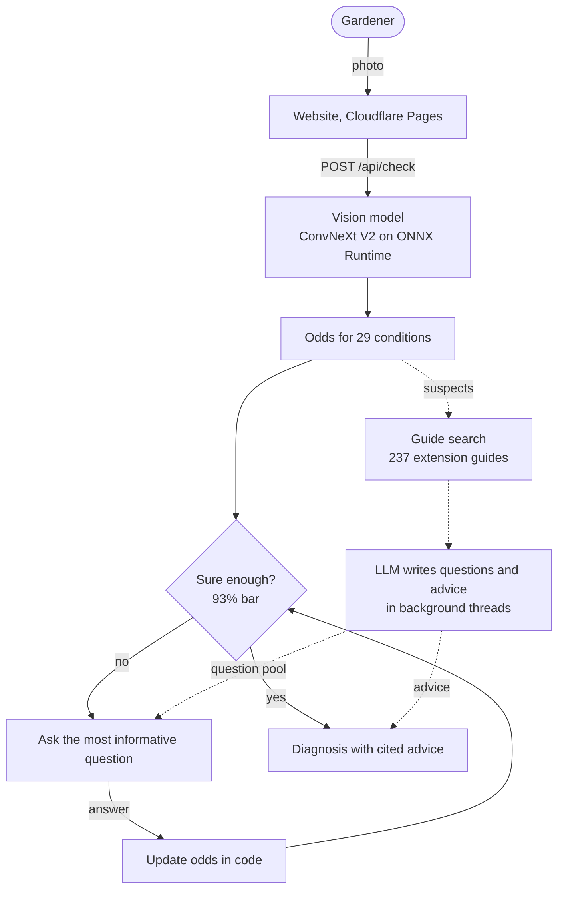

# SPROUT

**Smart Plant Recovery and Optimization Utility Tool.** Photograph a sick leaf: SPROUT names the likely disease, asks a few yes or no questions written from 237 university extension guides until it is sure, and gives care advice that cites the guide it came from.

- **Website:** `site/` (static, hosted on Cloudflare Pages): a home page, a step-by-step walkthrough, an architecture page and a live demo.
- **Vision model:** ConvNeXt V2 Tiny, fine-tuned on lab and field photos, 29 conditions across 14 plants.
- **Guide search:** hybrid BM25 + embedding search with a cross-encoder reranker over 237 extension guides.
- **Question engine:** the model's odds updated by code after each answer; the next question chosen by expected information gain.

| | |
|---|---|
| Right disease in the top three, from the photo alone | **96%** |
| University extension guides it reads from | **237** |
| Photo to diagnosis, median | **0.4 s** |
| Tap to next question, median | **6.5 ms** |

## How it works



The LLM only writes text. Every probability, every stop decision and the choice of the next question are plain code, so the same answers always give the same result.

## Architecture docs

| Doc | What it explains |
|---|---|
| [System overview](docs/architecture/system.md) | The parts, where each runs, and how they talk |
| [Life of a check](docs/architecture/check-lifecycle.md) | Every request from photo to chat, as sequence diagrams |
| [Question engine](docs/architecture/question-engine.md) | Odds, the plant question, information gain, the stop rule |
| [Guide search](docs/architecture/guide-search.md) | Ingest, two indexes, filtered hybrid search, reranking |
| [Vision model](docs/architecture/vision-model.md) | From photos to a calibrated ONNX model, and how a photo is read |
| [Live demo server](docs/architecture/live-demo-server.md) | Endpoints, background work, spend caps and safety |
| [Website](docs/architecture/website.md) | Pages, the live demo client and how it stays responsive |

## Run it

```
py -3.12 -m venv .venv
.venv/Scripts/python -m pip install torch torchvision --index-url https://download.pytorch.org/whl/cu128
.venv/Scripts/python -m pip install -e ".[dev]"
.venv/Scripts/python -m pytest -q
```

The live demo server serves the website and its API:

```
.venv/Scripts/python tools/live_demo.py --site site
```

then open `http://127.0.0.1:8765/live.html`. It needs the exported model in `models/` and the guide index in `knowledge/`, which are not in the repository (see [the vision model](docs/architecture/vision-model.md) and [guide search](docs/architecture/guide-search.md) docs for how they are built), and an LLM API key in `.env` as `SPROUT_ANTHROPIC_API_KEY`. Without a key it still works with 52 questions pre-extracted from the guides.

## What's where

| Path | What it is |
|---|---|
| `src/sprout/serve/` | Photo reading, the photo gate, calibration, the ONNX classifier |
| `src/sprout/rag/` | Guide ingest, the retriever, grounded answers |
| `src/sprout/train/`, `src/sprout/eval/`, `src/sprout/experiments/` | Training, metrics and the experiments behind every number |
| `src/sprout/web/` | A full Flask app with accounts and history |
| `tools/live_demo.py` | The live demo server behind the website |
| `site/` | The website |
| `tests/` | About 950 tests, run on every push |
| `configs/`, `results/runs/` | Experiment settings and the run records every number comes from |
| `docs/` | Design, evaluation report and the architecture docs |

## License

[MIT](LICENSE) for the code. Datasets, pretrained weights and extension guides keep their own licenses; none of them are included in this repository.
