<div align="center">


# SPROUT

**Smart Plant Recovery and Optimization Utility Tool**

Photograph a sick leaf. SPROUT names the disease, asks the few questions that settle it, and tells you what to do, citing the university extension guide the advice came from.

     

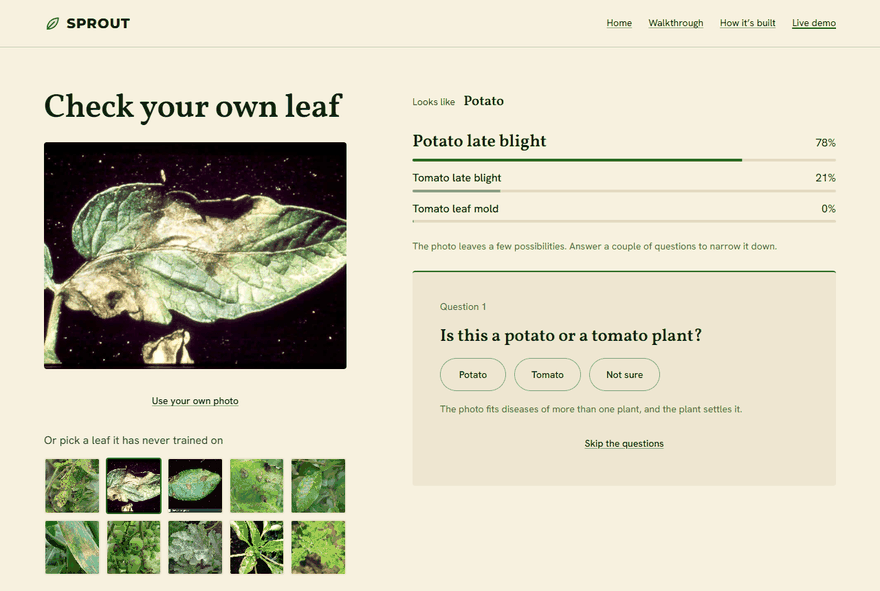

<sub>A real run on a tomato leaf the model never trained on.</sub>

</div>

---

## Contents

[What it does](#what-it-does) · [System overview](#system-overview) · [Life of a check](#life-of-a-check) · [Question engine](#question-engine) · [Guide search](#guide-search) · [Vision model](#vision-model) · [Live demo server](#live-demo-server) · [Website](#website) · [Built with](#built-with) · [Quick start](#quick-start) · [Repository map](#repository-map)

## What it does

A photo alone often can't tell look-alike leaf diseases apart. SPROUT combines three things to get to one answer:

1. **A vision model** trained on lab and field photos together, so it holds up on real garden photos, not just clean lab shots.
2. **A question engine** that asks short yes or no questions about what you can see, picked so each one narrows the odds the most, and stops as soon as it's sure.
3. **A search engine over 237 university extension guides.** The questions, the care advice and the chat replies are all written from guide passages, and each one names its source.

The design rule behind all of it: **an LLM writes the words, plain code does the counting.** Every probability, the choice of the next question and the decision to stop are code, so the same answers always give the same result.

---

## System overview

Four parts: a static website, one Python server, background threads inside that server, and an external LLM API that only writes text. The model and the guide index are built offline and loaded when the server starts.

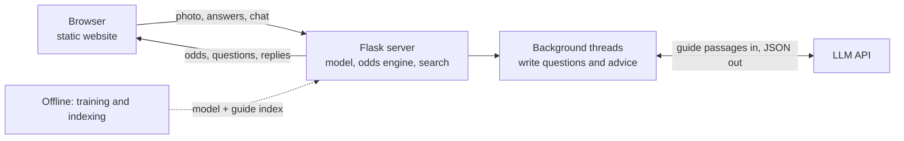

The browser holds nothing but the id of the current check; the server owns the odds. [**Full system overview →**](docs/architecture/system.md)

## Life of a check

One photo, a few taps, a diagnosis, then a conversation. The slow work (writing questions and advice) happens in the background while you read, so each tap only runs the odds engine.

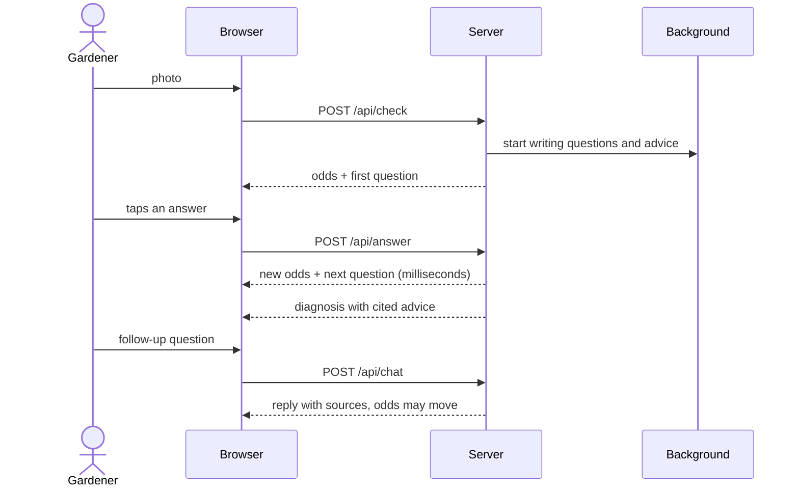

<table>
<tr>
<td width="50%">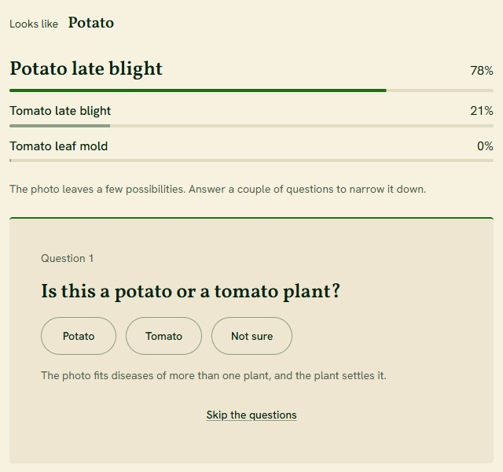</td>
<td width="50%">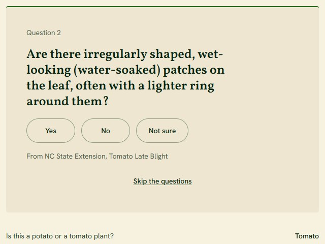</td>
</tr>
<tr>
<td>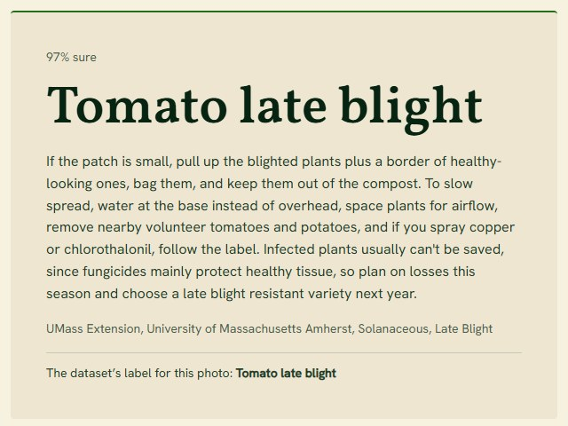</td>
<td>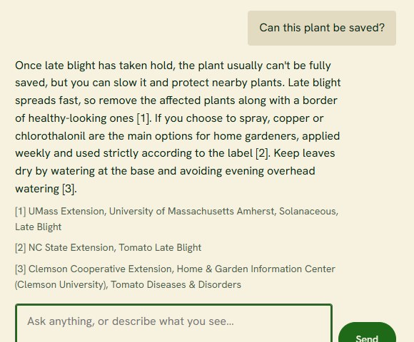</td>
</tr>
</table>

[**Every request, step by step →**](docs/architecture/check-lifecycle.md)

## Question engine

The loop that turns uncertain odds into one answer. If the suspects belong to different plants, it asks about the plant first. Otherwise it asks the question expected to leave the least uncertainty, updates the odds, and repeats until one condition is sure.

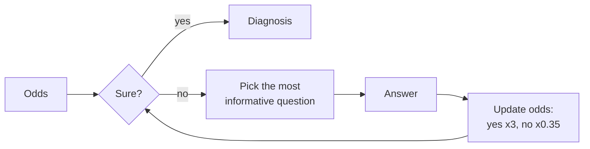

[**Odds updates, information gain and the stop rule →**](docs/architecture/question-engine.md)

## Guide search

Everything SPROUT says starts from a passage in 237 extension guides. The search filters to the plant and disease in question, combines keyword and embedding search, and lets a cross-encoder pick the best passages.

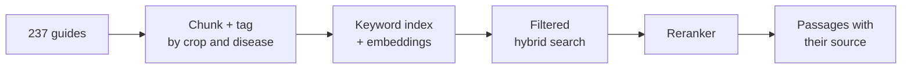

[**How the index is built and searched →**](docs/architecture/guide-search.md)

## Vision model

ConvNeXt V2 Tiny, fine-tuned to recognise 29 conditions across 14 plants, then calibrated so its confidence means something and exported to ONNX for fast CPU serving. A photo gate turns away images that aren't leaves.

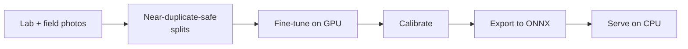

[**From photos to a served model, and how one photo is read →**](docs/architecture/vision-model.md)

## Live demo server

A single Flask process (`tools/live_demo.py`) that serves the website and its JSON API. It prepares text ahead of time so taps are instant, and caps spending per visitor, per IP and per day so it is safe to leave running.

| Endpoint | Does |
|---|---|
| `POST /api/check` | Reads the photo, returns the odds and the first question |
| `POST /api/answer` | Applies an answer, returns the next question or the diagnosis |
| `POST /api/next` | Waits for the next question when one is still being written |
| `POST /api/advice` | Returns the diagnosis once its advice is written |
| `POST /api/chat` | Answers a follow-up from the guides |

[**Background work, limits and concurrency →**](docs/architecture/live-demo-server.md)

## Website

Plain HTML, CSS and JavaScript in `site/`, no framework: a home page, an eight-step walkthrough, an architecture page and the live demo. The live demo client marks your tap instantly, animates the odds, and drops stale replies when you switch photos.

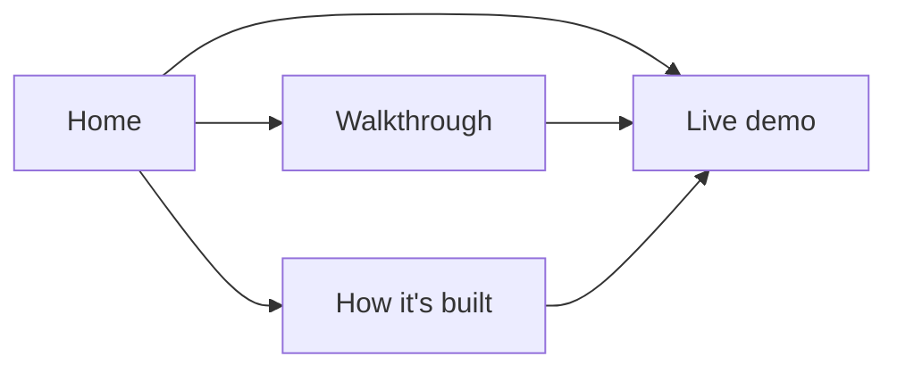

[**Pages, the demo client and its states →**](docs/architecture/website.md)

---

## Built with

| Area | Tools |
|---|---|
| **Vision** | PyTorch, timm (ConvNeXt V2 Tiny, ImageNet-22k pretrained), CUDA mixed precision, ONNX Runtime |
| **Search** | BM25, BGE-small embeddings via fastembed, MiniLM cross-encoder reranker, pypdf |
| **Server** | Python, Flask, a background thread pool, an LLM API for text |
| **Data and evaluation** | DVC, MLflow, perceptual hashing and DINOv2 near-duplicate checks, bootstrap confidence intervals, McNemar's test, calibration |
| **Website** | Hand-written HTML, CSS and JavaScript, inline SVG diagrams, no framework |
| **Quality** | pytest (about 950 tests), ruff, GitHub Actions CI |

## Quick start

```bash
python -m venv .venv
.venv/Scripts/python -m pip install torch torchvision --index-url https://download.pytorch.org/whl/cu128
.venv/Scripts/python -m pip install -e ".[dev]"
.venv/Scripts/python -m pytest -q
```

Run the live demo, which serves the website and its API:

```bash
.venv/Scripts/python tools/live_demo.py --site site
# then open http://127.0.0.1:8765/live.html
```

The demo needs the exported model in `models/` and the guide index in `knowledge/` (built as described in the [vision model](docs/architecture/vision-model.md) and [guide search](docs/architecture/guide-search.md) docs), plus an LLM API key in `.env` as `SPROUT_ANTHROPIC_API_KEY`. Without a key it still runs, using 52 questions pre-extracted from the guides.

## Repository map

```
src/sprout/
  serve/        photo reading, the photo gate, calibration, the ONNX classifier
  rag/          guide ingest, the retriever, grounded answers
  train/ eval/  training loops, metrics, run records
  experiments/  the experiments behind every reported number
  web/          a full Flask app with accounts and history
tools/live_demo.py   the live demo server behind the website
site/                the website
docs/architecture/   the deep dives linked above
tests/               about 950 tests, run on every push
configs/ results/    experiment settings and the run records every number comes from
```

## Author

**Aakash Senthilnathan**, Statistics and Data Science at UC Santa Barbara.
[LinkedIn](https://www.linkedin.com/in/aakashsenthilnathan/) · [GitHub](https://github.com/aakashksen) · aakash.senthilnathan@gmail.com

## License

[MIT](LICENSE) for the code. Datasets, pretrained weights and extension guides keep their own licenses and are not included. Sample leaf photos on the website come from the PlantDoc (CC BY 4.0) and PlantSeg (CC BY-NC 4.0) datasets.
