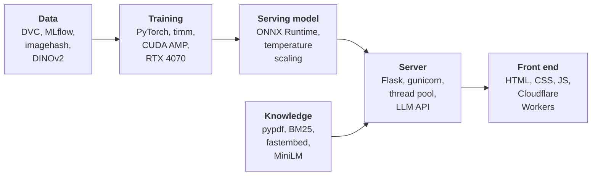
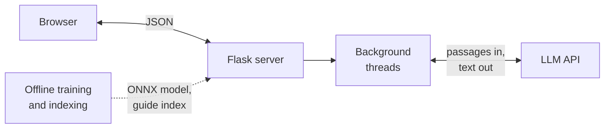
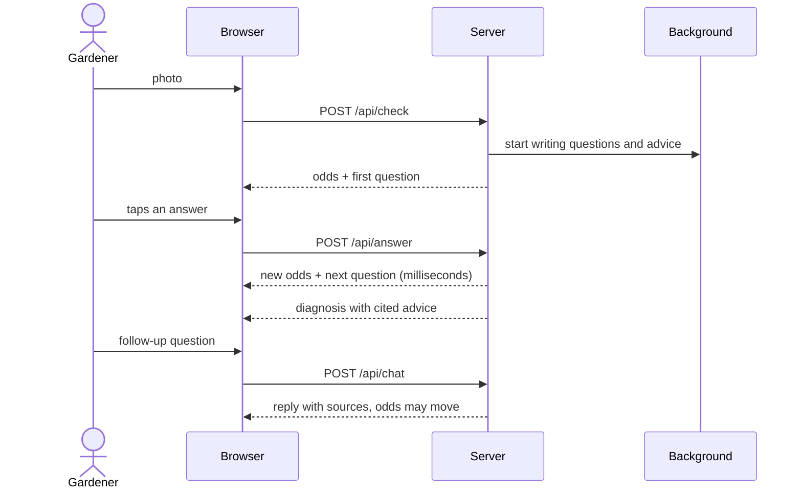
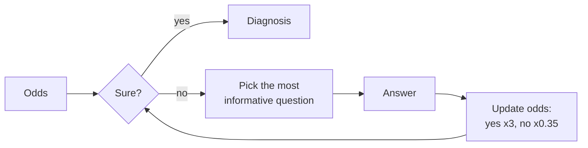
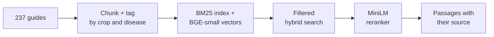
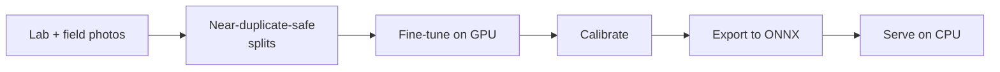
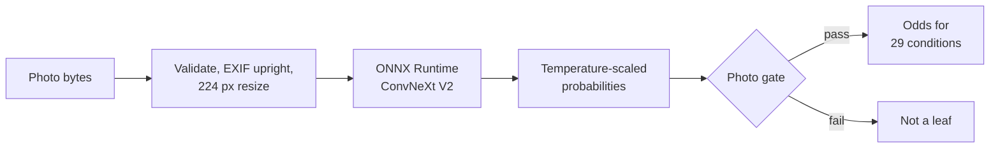
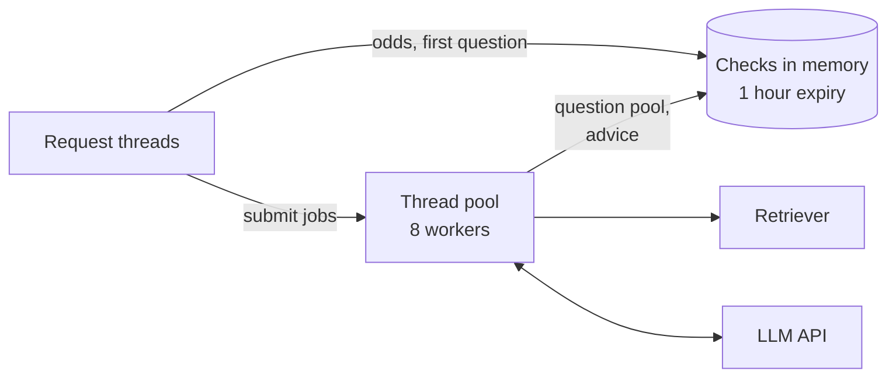
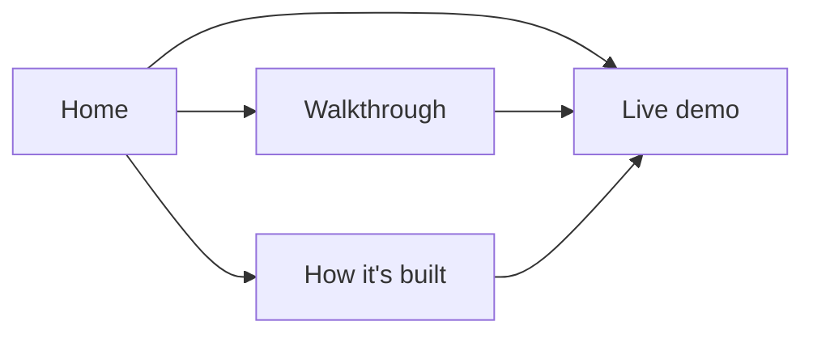
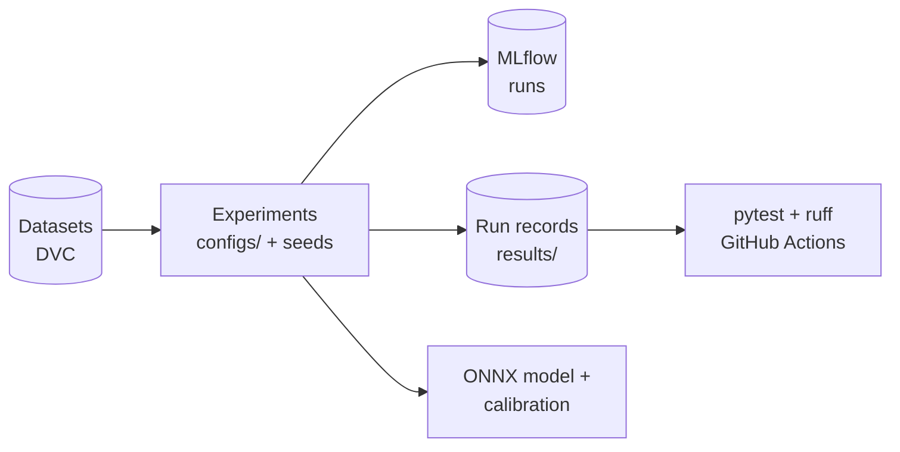

<div align="center">


# SPROUT

**Smart Plant Recovery and Optimization Utility Tool**

Photograph a sick leaf. SPROUT names the disease, asks the few questions that settle it, and tells you what to do, citing the university extension guide the advice came from.

     

### [See it running: sprout.aakashsenthilnathan.com](https://sprout.aakashsenthilnathan.com)

[Walkthrough](https://sprout.aakashsenthilnathan.com/tour.html) · [How it's built](https://sprout.aakashsenthilnathan.com/specs.html) · [Live demo](https://sprout.aakashsenthilnathan.com/live.html)

</div>

---

## Contents

[What it does](#what-it-does) · [The stack](#the-stack) · [System overview](#system-overview) · [Life of a check](#life-of-a-check) · [Question engine](#question-engine) · [Guide search](#guide-search) · [Vision model](#vision-model) · [Live demo server](#live-demo-server) · [Website](#website) · [Data and experiments](#data-and-experiments) · [Quick start](#quick-start) · [Repository map](#repository-map)

## What it does

A photo alone often can't tell look-alike leaf diseases apart. SPROUT combines three things to get to one answer:

1. **A vision model**: ConvNeXt V2 Tiny, trained on lab and field photos together, giving calibrated odds over 29 conditions on 14 plants.
2. **A question engine** that asks short yes or no questions, picked so each one narrows the odds the most, and stops as soon as it's sure.
3. **A search engine over 237 university extension guides.** The questions, the care advice and the chat replies are all written from guide passages, and each one names its source.

The design rule behind all of it: **an LLM writes the words, plain code does the counting.** Every probability, the choice of the next question and the decision to stop are code, so the same answers always give the same result.

## The stack

Every layer, from the training GPU to the page in the browser.



| Layer | Technology | Role |
|---|---|---|
| Vision model | PyTorch, timm, ConvNeXt V2 Tiny (ImageNet-22k pretrained) | Reads the leaf and gives odds over 29 conditions |
| Training | CUDA mixed precision (AMP, GradScaler), AdamW, cosine schedule, RTX 4070 | Fine-tunes on lab and field photos |
| Data hygiene | `imagehash` perceptual hashing, DINOv2 (transformers), group-aware splits | Keeps near-duplicate photos on one side of a split |
| Calibration | Temperature scaling, abstention bar, photo gate | Makes confidence mean something and rejects non-leaves |
| Model export | ONNX, ONNX Runtime (CPU), Pillow and NumPy preprocessing | PyTorch-free serving image |
| Search | pypdf, BM25, BGE-small embeddings via fastembed, MiniLM cross-encoder reranker | Finds the right guide passage for a plant and a disease |
| Question engine | Plain Python: odds multipliers, expected information gain, stop rule | Chooses questions and the diagnosis; no LLM involved |
| Server | Flask, gunicorn, `ThreadPoolExecutor`, signed session cookies | JSON API, background writing, spend caps, rate limits |
| Text | An LLM API for the live demo; a local LLM through Ollama for the full app | Words only, never numbers |
| Front end | Hand-written HTML, CSS and JavaScript, inline SVG, no framework | Walkthrough, architecture page, live demo |
| Hosting | Cloudflare Workers static assets (site), Docker image with gunicorn (full app) | sprout.aakashsenthilnathan.com |
| Tracking and quality | MLflow, DVC, JSON run records, pytest, ruff, GitHub Actions | Reproducible runs and checked code |

## System overview

Four parts: a static website, one Python server, background threads inside that server, and an external LLM API that only writes text. The model and the guide index are built offline and loaded when the server starts.



The browser holds nothing but the id of the current check; the server owns the odds. The same core (identifier, retriever, guide manifest) also backs a second app, `src/sprout/web`: a full Flask app with accounts, upload history and a local LLM through Ollama.

[**Full system overview**](docs/architecture/system.md)

## Life of a check

One photo, a few taps, a diagnosis, then a conversation. The slow work (writing questions and advice) happens in the background while you read, so each tap only runs the odds engine.



<table>
<tr>
<td width="50%"></td>
<td width="50%"></td>
</tr>
<tr>
<td></td>
<td></td>
</tr>
</table>

[**Every request, step by step**](docs/architecture/check-lifecycle.md)

## Question engine

Plain Python that turns uncertain odds into one answer. If the suspects belong to different plants, it asks about the plant first. Otherwise it asks the question expected to leave the least uncertainty (expected information gain), updates the odds with fixed multipliers, and repeats until one condition is sure or the question budget runs out. An LLM only phrases the candidate questions, from guide passages; it never touches a number.



[**Odds updates, information gain and the stop rule**](docs/architecture/question-engine.md)

## Guide search

Everything SPROUT says starts from a passage in 237 extension guides. Guides are extracted with pypdf, chunked, and tagged by crop and disease. A search filters to the plant and disease in question, merges BM25 keyword scores with BGE-small embedding similarity (fastembed), and lets a MiniLM cross-encoder reranker pick the best passages. The same retriever grounds questions, advice and chat.



[**How the index is built and searched**](docs/architecture/guide-search.md)

## Vision model

ConvNeXt V2 Tiny fine-tuned with PyTorch and timm on a CUDA GPU with mixed precision, on lab and field photos together so it holds up on real garden photos. Splits are made so near-duplicate photos never straddle train and test (perceptual hashes, plus DINOv2 similarity for extra sources). Temperature scaling calibrates the confidence, the model is exported to ONNX and served on CPU with ONNX Runtime, and a photo gate turns away images that aren't leaves.



Reading one photo at serving time:



[**From photos to a served model, and how one photo is read**](docs/architecture/vision-model.md)

## Live demo server

A single Flask process (`tools/live_demo.py`) that serves the website and its JSON API. A request thread answers immediately with odds and the first question, while an 8-worker thread pool writes the next questions and the advice through the LLM API. Per-visitor, per-IP and daily spend caps, per-IP photo rate limits, per-check locks and in-memory checks that expire after an hour keep it safe to leave running.



| Endpoint | Does |
|---|---|
| `POST /api/check` | Reads the photo, returns the odds and the first question |
| `POST /api/answer` | Applies an answer, returns the next question or the diagnosis |
| `POST /api/next` | Waits for the next question when one is still being written |
| `POST /api/advice` | Returns the diagnosis once its advice is written |
| `POST /api/chat` | Answers a follow-up from the guides |

[**Background work, limits and concurrency**](docs/architecture/live-demo-server.md)

## Website

Plain HTML, CSS and JavaScript in `site/`, no framework and no build step, published as static assets on Cloudflare Workers: a home page, an eight-step walkthrough, an architecture page and the live demo. The live demo client marks your tap instantly, animates the odds, and drops stale replies when you switch photos.



[**Pages, the demo client and its states**](docs/architecture/website.md)

## Data and experiments

Training and evaluation are reproducible end to end. DVC versions the datasets, MLflow logs the training and evaluation runs, and each experiment under `src/sprout/experiments` takes its settings from `configs/` and writes a JSON run record under `results/` that the reported numbers are read from.



---

## Quick start

```bash
python -m venv .venv
.venv/Scripts/python -m pip install torch torchvision --index-url https://download.pytorch.org/whl/cu128
.venv/Scripts/python -m pip install -e ".[dev]"
.venv/Scripts/python -m pytest -q
```

Run the live demo, which serves the website and its API:

```bash
.venv/Scripts/python tools/live_demo.py --site site
# then open http://127.0.0.1:8765/live.html
```

The demo needs the exported model in `models/` and the guide index in `knowledge/` (built as described in the [vision model](docs/architecture/vision-model.md) and [guide search](docs/architecture/guide-search.md) docs), plus an LLM API key in `.env` (the variable name is in `tools/live_demo.py`). Without a key it still runs, using 52 questions pre-extracted from the guides.

## Repository map

```
src/sprout/
  serve/        photo reading, the photo gate, calibration, the ONNX classifier
  rag/          guide ingest, the retriever, grounded answers
  train/ eval/  training loops, metrics, run records
  experiments/  the experiments behind every reported number
  web/          a full Flask app with accounts and history
tools/live_demo.py   the live demo server behind the website
site/                the website
docs/architecture/   the deep dives linked above
tests/               the pytest suite, run on every push
configs/ results/    experiment settings and the run records every number comes from
deploy/              Dockerfile, gunicorn entry point for the full app
```

## Author

**Aakash Senthilnathan**, Statistics and Data Science at UC Santa Barbara.
[LinkedIn](https://www.linkedin.com/in/aakashsenthilnathan/) · [GitHub](https://github.com/aakashksen) · aakash.senthilnathan@gmail.com

## License

[MIT](LICENSE) for the code. Datasets, pretrained weights and extension guides keep their own licenses and are not included. Sample leaf photos on the website come from the PlantDoc (CC BY 4.0) and PlantSeg (CC BY-NC 4.0) datasets.
