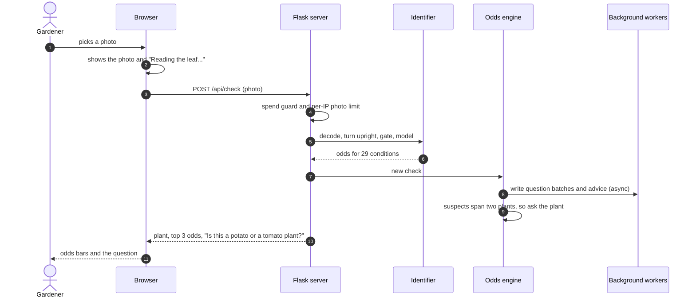
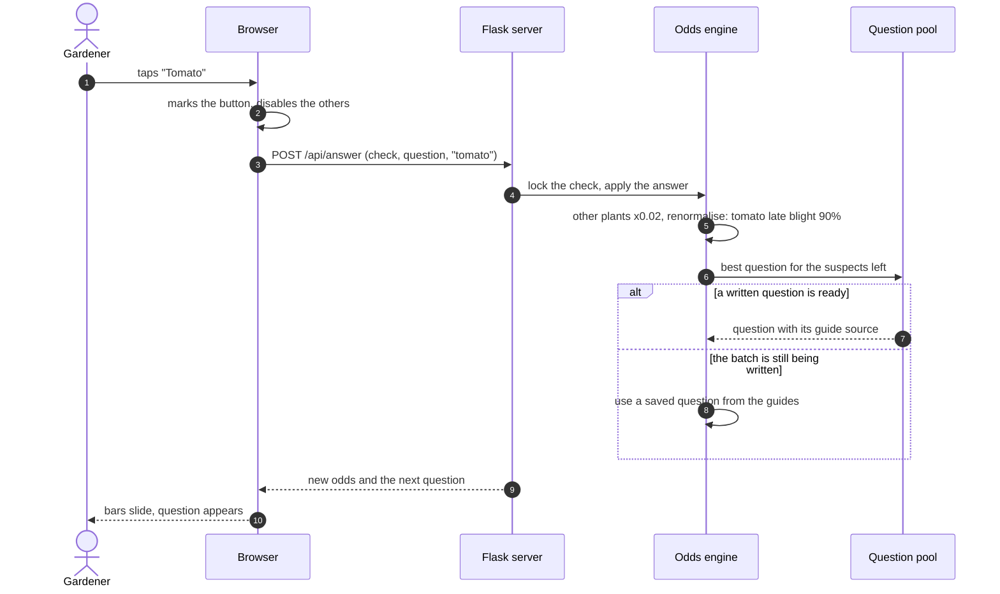
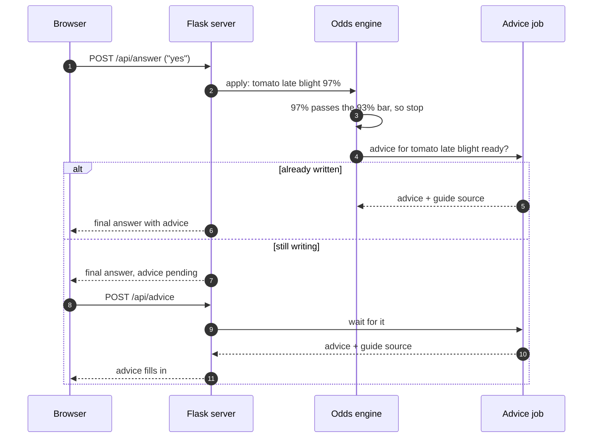
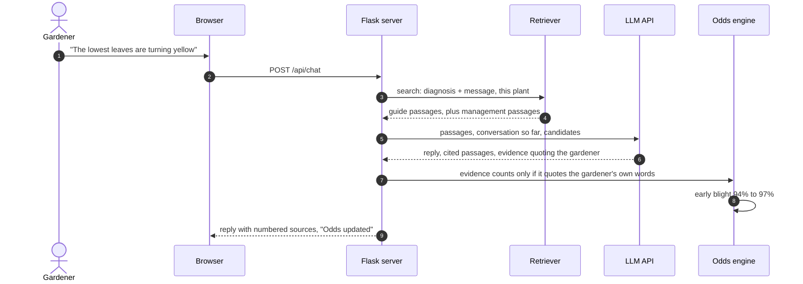
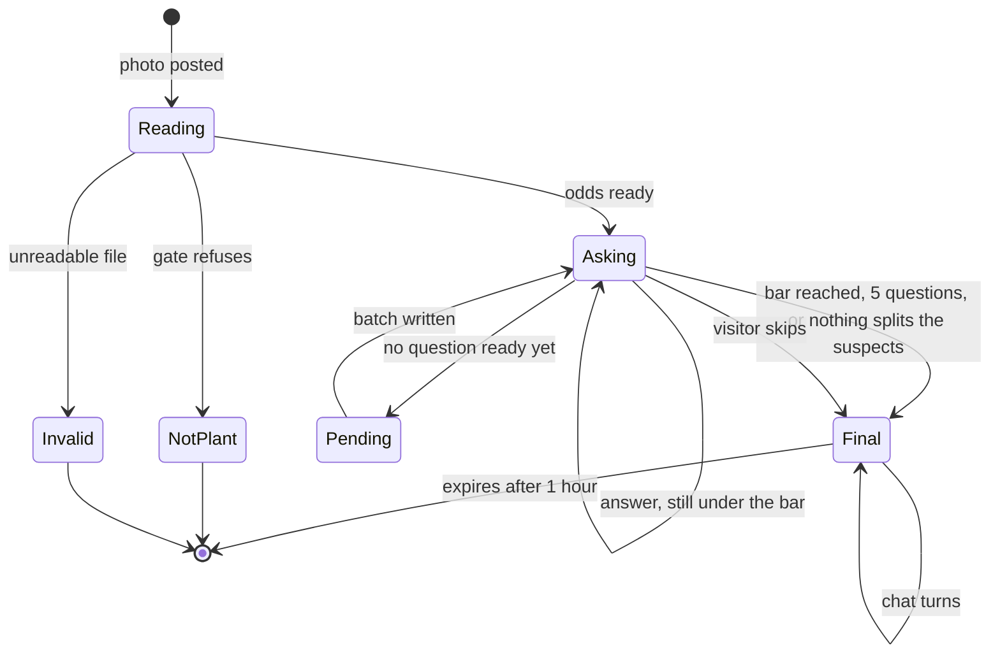

# Life of a check

[Back to README](../../README.md) · Previous: [System overview](system.md) · Next: [Question engine](question-engine.md)

One "check" is one photo, the questions that follow it, the diagnosis and any chat. These diagrams follow a real run: a tomato leaf with late blight that the photo alone read as potato late blight.

## 1. Photo in, odds out (about 0.4 s)

## 2. Answering (median 6.5 ms per tap)

## 3. The answer, with advice that was written early

## 4. Chat that can move the odds

## States a check moves through

Related: [Question engine](question-engine.md), [Live demo server](live-demo-server.md).
