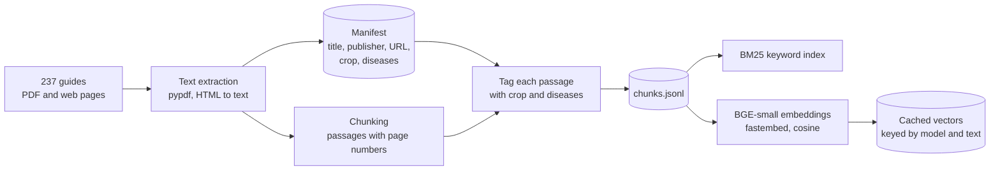
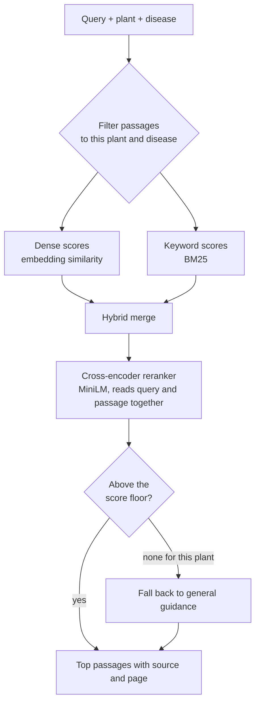
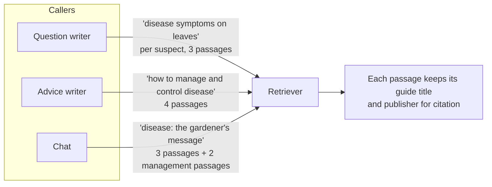

# Guide search

[Back to README](../../README.md) · Previous: [Question engine](question-engine.md) · Next: [Vision model](vision-model.md)

Every question, piece of advice and chat reply starts from passages in 237 university extension guides. The search has to find the passage about *this* disease on *this* plant, not a generic one.

## Building the index (offline)

A guide that covers several plants is tagged with each plant its title or disease list names, so a pepper question can still reach a page filed under tomato.

## One search

## Why the reranker

The hybrid merge finds the right neighbourhood; the reranker, which reads the question and the passage together, puts the right passage first. On the evaluation questions, the right passage lands in the top five 83% of the time with reranking, against 72% for embedding search alone.

## How each feature uses it

Searches are serialised behind one lock because the retriever and its models are shared by all background workers.

Related: [Question engine](question-engine.md), [System overview](system.md).
