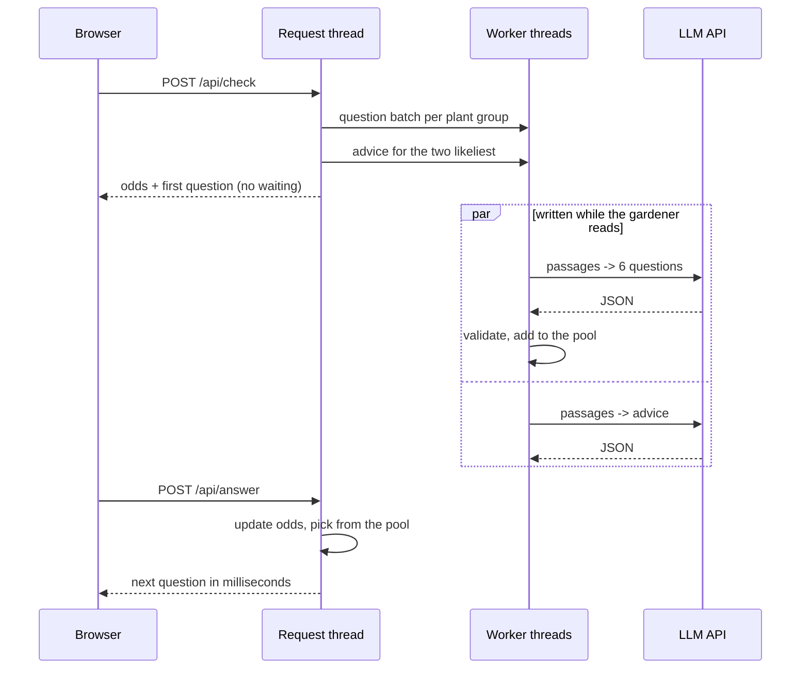
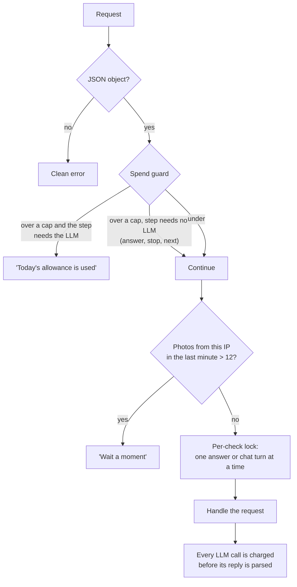
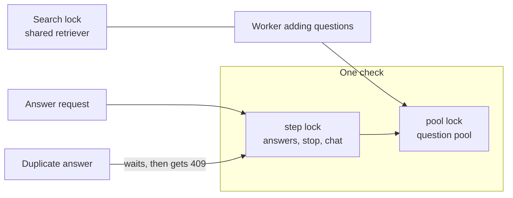

# Live demo server

[Back to README](../../README.md) · Previous: [Vision model](vision-model.md) · Next: [Website](website.md)

`tools/live_demo.py` is a single Flask process that serves the website and the API behind the live demo. It is built to feel instant and to be safe to leave running.

## Endpoints

| Method and path | Body | Returns | Calls the LLM? |
|---|---|---|---|
| `POST /api/check` | photo (multipart) | plant, top 3 odds, first question or `pending` | starts background jobs |
| `POST /api/next` | check id | the next question once one is ready | no |
| `POST /api/answer` | check id, question id, answer or `stop` | new odds, next question or the final answer | no |
| `POST /api/advice` | check id | the final answer with its advice | no (waits for the job) |
| `POST /api/chat` | check id, text | reply, numbered sources, odds shift | yes |
| `GET /*` | | the website; `live.html` is served with the API switched on | no |

## Why taps are instant

## Safety and cost limits

| Limit | Value |
|---|---|
| Spend per visitor (signed session cookie) | $1 a day |
| Spend per IP address | $3 a day |
| Spend for the whole server | $10 a day |
| Photos per IP | 12 a minute |
| A check is kept for | 1 hour, at most 2000 at once |
| LLM call timeout | 30 s, one retry |
| Upload size | 20 MB |

Photos are read in memory and discarded. The API key is read from `.env` and never sent to the browser. If no key is set, questions come from the 52 saved guide questions and the chat is off.

## Concurrency model

A repeated answer (double click, retry, second tab) is applied once; the copy gets a JSON 409 with the current state.

Related: [Life of a check](check-lifecycle.md), [Website](website.md).
