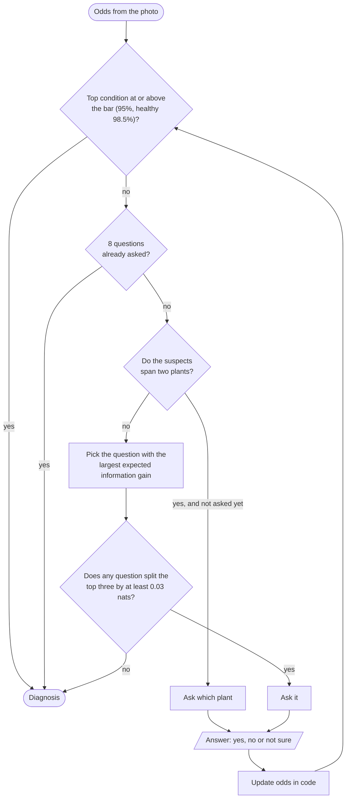
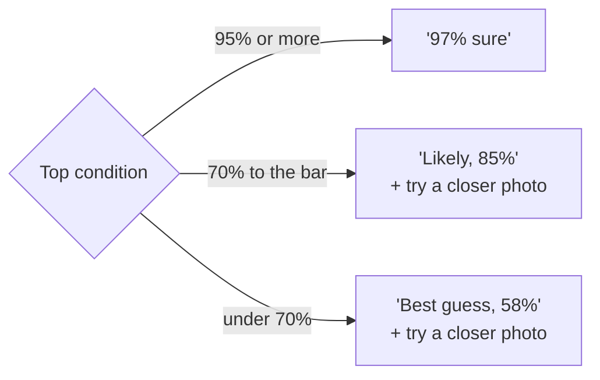
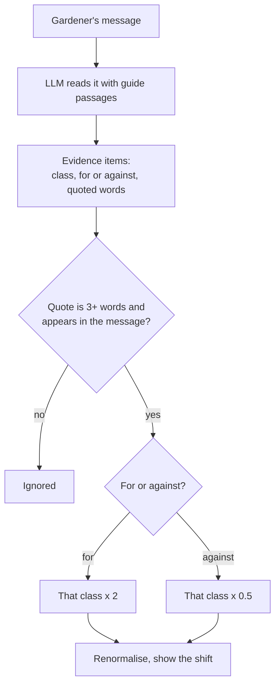

# Question engine

[Back to README](../../README.md) · Previous: [Life of a check](check-lifecycle.md) · Next: [Guide search](guide-search.md)

A photo alone often cannot separate look-alike diseases. The question engine asks the fewest yes or no questions that settle it. The rule that shapes everything here: **an LLM writes words, code does the counting.** Since E18 the questions are a fixed bank written ahead of time from the guides, and no language model is involved at question time.

**Follow-up questions raise field accuracy from 81.3% to 95.2% with 10% of answers wrong.** The answers behind these numbers came from a simulated grower (separate AI agents given only the question, the true disease's name and its guide excerpts, never which diseases the question was written to separate), not from real people, so read them as an upper bound.

| `field_test`, 1,006 photos, everything fitted on `field_dev` | Accuracy |
|---|---|
| Photo only | 81.3% |
| Plus the plant question | 84.0% |
| Plus the new questions, perfect answers (157 fixed, 1 broken) | 96.8% |
| ... 10% of answers flipped (mean of 20 seeds) | 95.2% |
| ... 20% flipped | 91.8% |
| ... 20% answered "not sure" | 96.5% |
| The earlier (E11) questions, same answers, original rule | 86.6% |

A photo that gets questions gets about 2.8, and when SPROUT says it is 93% or more sure it is right about 97% of the time. The record is `results/runs/E18-20261115T011841523017Z.json`; the write-up is in `docs/REPORT.md`, "Follow-up questions, second try".

## The loop

## The question bank

`datasets/followup_v2/questions.jsonl` holds 54 questions. Each was written from the extension guides, carries the guide passages behind it, and says which diseases a "yes" supports and which a "no" supports. They were aimed at the pairs the final model most often confuses, and 28 of them are about things a photo cannot show: the underside of the leaf, the stem, the fruit, how the problem spread, timing and weather. Some support "healthy".

## Updating the odds

For one question, every disease is in one of three roles: a "yes" supports it, a "no" supports it, or neither. An answer multiplies each disease by the fitted likelihood of that answer for its role, then the odds are rescaled to add up to 100%. The fitted likelihoods (`configs/e18_params.json`, fitted on `field_dev` against a noisy simulated grower) are:

| Role | P(yes) | P(no) | P(not sure) |
|---|---|---|---|
| A "yes" supports it | 0.804 | 0.053 | 0.143 |
| A "no" supports it | 0.167 | 0.597 | 0.236 |

A disease the question does not mention uses the average of the two rows. Each later question counts 0.974 as much as the one before it, because answers overlap. The plant question is separate: answering "tomato" keeps tomato's conditions and multiplies every other plant's by 0.02.

Worked example (a real run of the engine on an illustrative start): early blight 60%, Septoria 24%, late blight 8%. A yes to "Do the spots have dark rings inside them, like a target or bull's-eye?" takes early blight to 85%; a yes to "Are there dark, elongated spots or cankers on the stems?" to 93%; a yes to "Did the problem start on the oldest, lowest leaves?" to 96%, which passes the 95% bar.

## Choosing the next question

For each unasked question the engine simulates all three answers on the current top three diseases (their odds renormalised), weights them by how likely each answer is under those odds and the fitted likelihoods, and keeps the question with the largest expected information gain. A question is skipped if it was already asked or if it would split the top three by less than 0.03 nats.

## Where the questions came from

Writing the bank was a one-time step: guide passages were found per disease, questions were drafted from them and checked in code (each cites a passage of a disease it supports, ends in "?" and is short). The demo no longer writes questions at run time, so a tap only runs the odds engine and the next question appears in milliseconds.

## When it stops, and what it says

The bar is 95%, and a "healthy" result needs a stricter one (98.5%); both were fitted on `field_dev`. On held-out field photos, when SPROUT says it is 93% or more sure it is right about 97% of the time.

## Chat as evidence

A plain question such as "can it be saved?" carries no evidence and never moves the odds.

Related: [Guide search](guide-search.md), [Life of a check](check-lifecycle.md).
