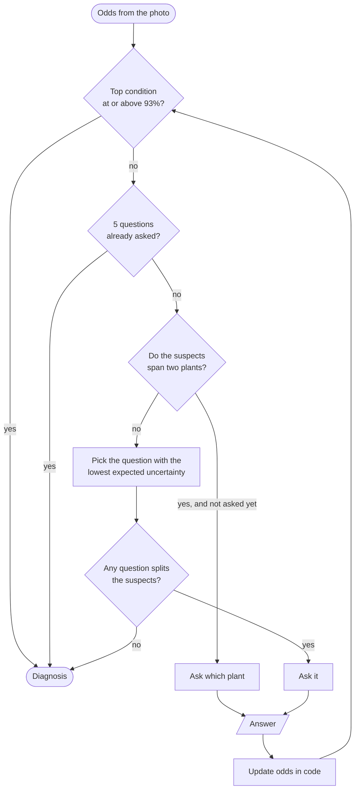
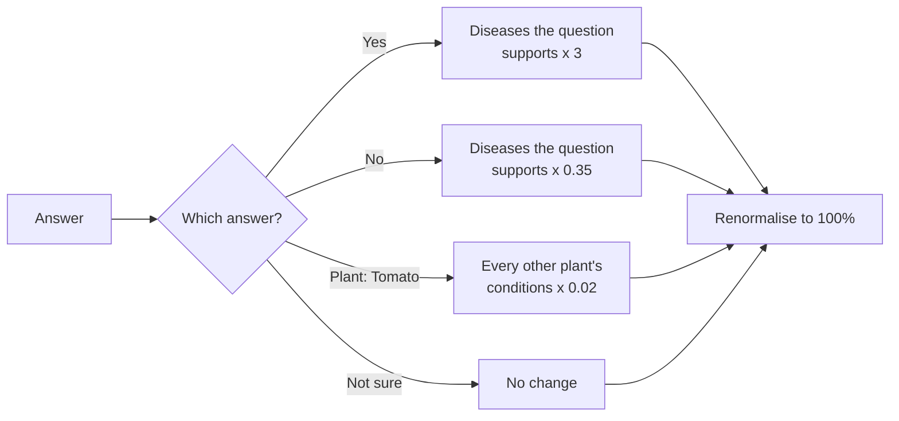
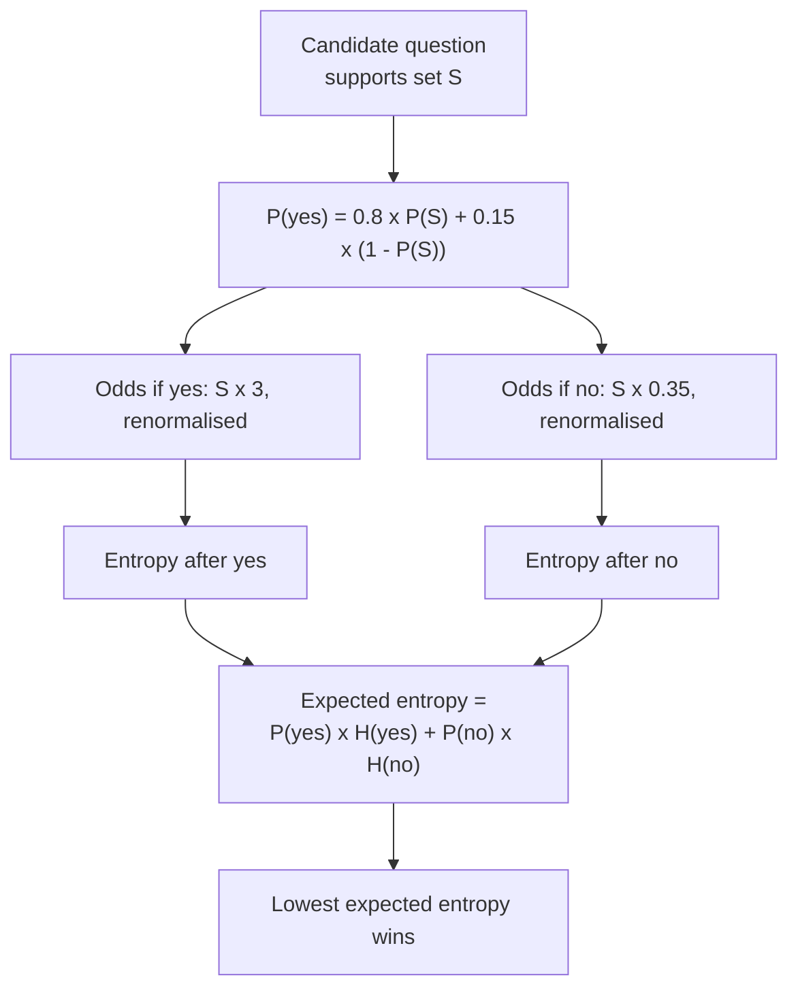
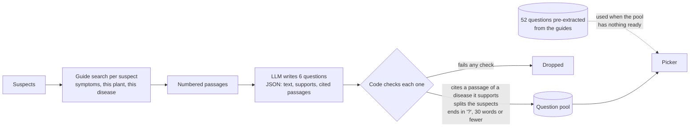
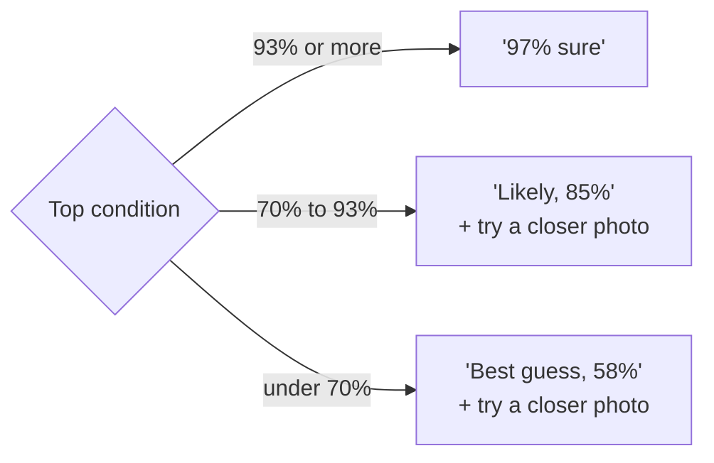
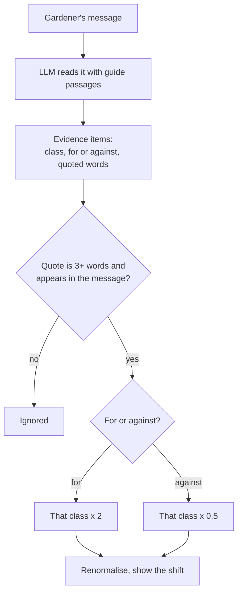

# Question engine

[Back to README](../../README.md) · Previous: [Life of a check](check-lifecycle.md) · Next: [Guide search](guide-search.md)

A photo alone often cannot separate look-alike diseases. The question engine asks the fewest yes or no questions that settle it. The rule that shapes everything here: **the LLM writes words, code does the counting.**

## The loop

## Who the suspects are

The candidates are the top three conditions, plus the fourth and fifth if each still holds at least 5%. Questions are only useful if they separate these.

## Updating the odds

Worked example: early blight at 54%, Septoria 27%, late blight 11%, the rest 8%. A yes to "rings inside the spots, like a target?" multiplies early blight by 3: 162 against 27 + 11 + 8 = 46, so early blight becomes 162 / 208 = 78%.

## Choosing the next question

Every candidate question says which diseases a "yes" supports. For each one, the engine simulates both answers and keeps the question that leaves the least uncertainty on average.

A question is skipped if it was already asked, if it supports none of the current suspects, or if it supports all of them (it could not separate anything).

## Where the questions come from

Batches are written in the background as soon as the photo is read: one batch for the current suspects and one for each plant group in the running, so answering the plant question never waits for writing.

## When it stops, and what it says

The 93% bar is the model's calibrated abstention threshold: on held-out photos, the ones it answers at that bar are right 95% of the time. A "healthy" result needs a stricter bar (96.5%).

## Chat as evidence

A plain question such as "can it be saved?" carries no evidence and never moves the odds.

Related: [Guide search](guide-search.md), [Life of a check](check-lifecycle.md).
