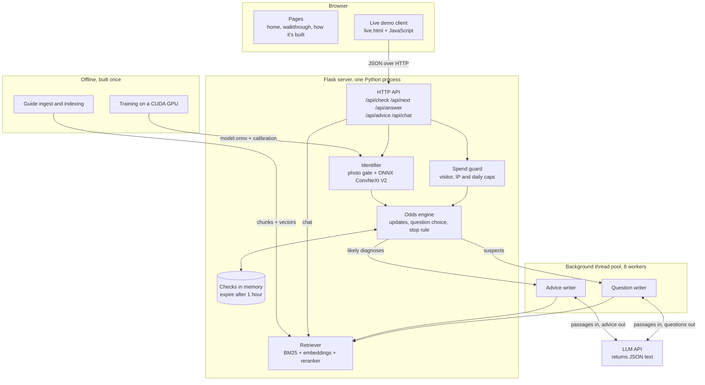
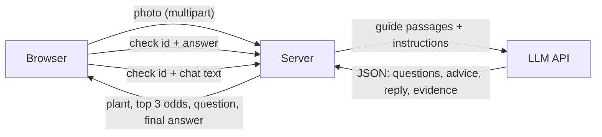
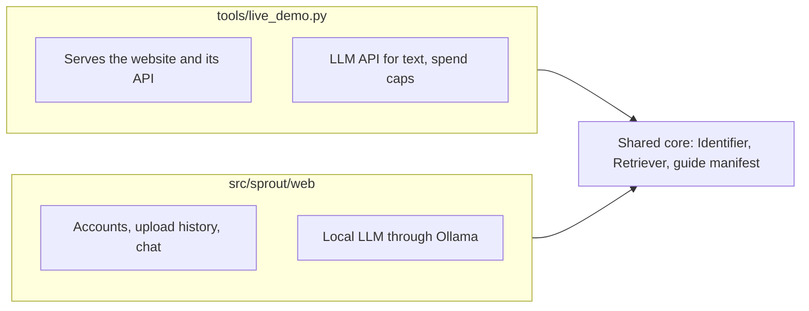

# System overview

[Back to README](../../README.md) · Next: [Life of a check](check-lifecycle.md)

SPROUT has four parts: a static website, one Python server, a set of background threads inside that server, and an external LLM API that only writes text. A separate offline pipeline produces the model and the guide index the server loads at start-up.

## Where everything runs

## Who owns what

| Part | Owns | Never does |
|---|---|---|
| Browser | Rendering, the current check id, optimistic button states | Hold odds or decide anything |
| Flask server | Every check's odds, history and questions | Trust anything the browser computes |
| Odds engine | Probabilities, the next question, when to stop | Call the LLM |
| Background workers | Writing questions and advice ahead of time | Change the odds |
| LLM API | Wording questions, advice and chat replies as JSON | Produce numbers that reach the user |
| Retriever | Finding guide passages for a plant and a disease | Generate text |

## Data that crosses each boundary

The photo is read in memory and never written to disk. The LLM never sees the photo; it sees guide passages, the candidate disease names, and the visitor's chat text.

## Two web apps

Both apps load the same identifier and retriever from `src/sprout`, so a photo gets the same reading in either.

Related: [Live demo server](live-demo-server.md), [Website](website.md).
