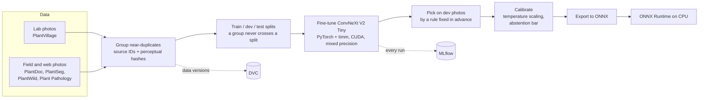
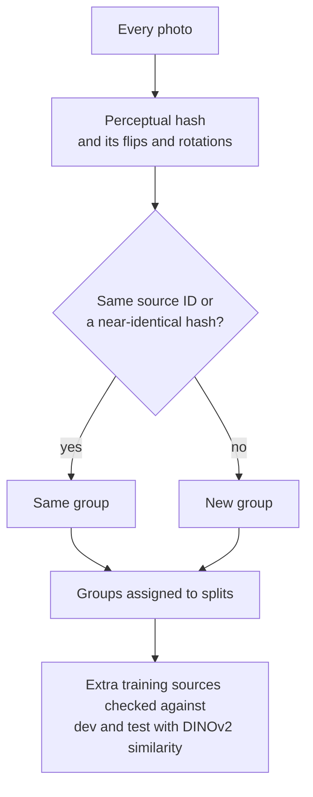
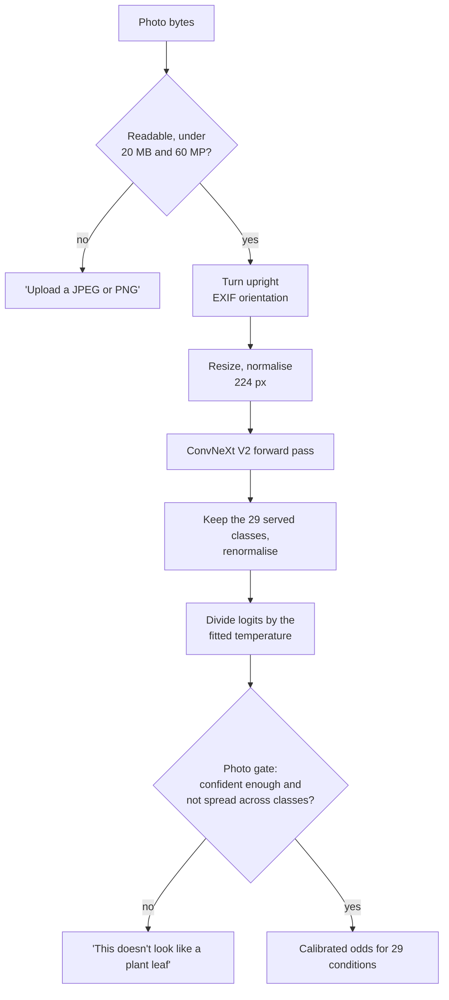

# Vision model

[Back to README](../../README.md) · Previous: [Guide search](guide-search.md) · Next: [Live demo server](live-demo-server.md)

ConvNeXt V2 Tiny, fine-tuned to recognise 29 conditions across 14 plants. The first model, trained on clean lab photos only, fell apart on real field photos; training on lab and field photos together is what fixed it.

## From photos to a served model

## Keeping the test honest

Look-alike photos of the same leaf can otherwise sit on both sides of the split and inflate the score.

## Reading one photo

## Results that shaped the design

| Model | Macro-F1 on held-out field photos |
|---|---|
| Trained on lab photos only | 0.24 |
| DINOv2 with a linear head | 0.72 |
| ConvNeXt V2 Tiny, lab and field photos together | **0.81** |

The right condition is in the top three 96% of the time, and on the photos the model answers at its calibrated bar it is right 95% of the time.

Related: [System overview](system.md), [Question engine](question-engine.md).
