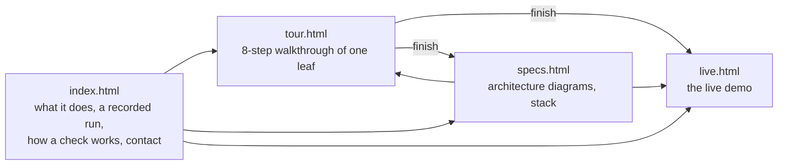
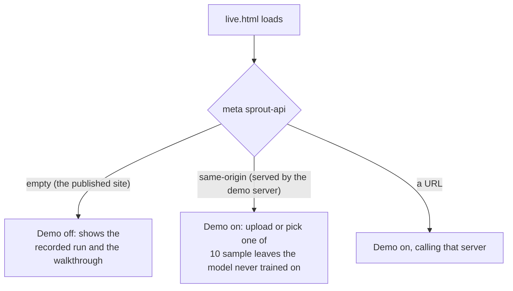
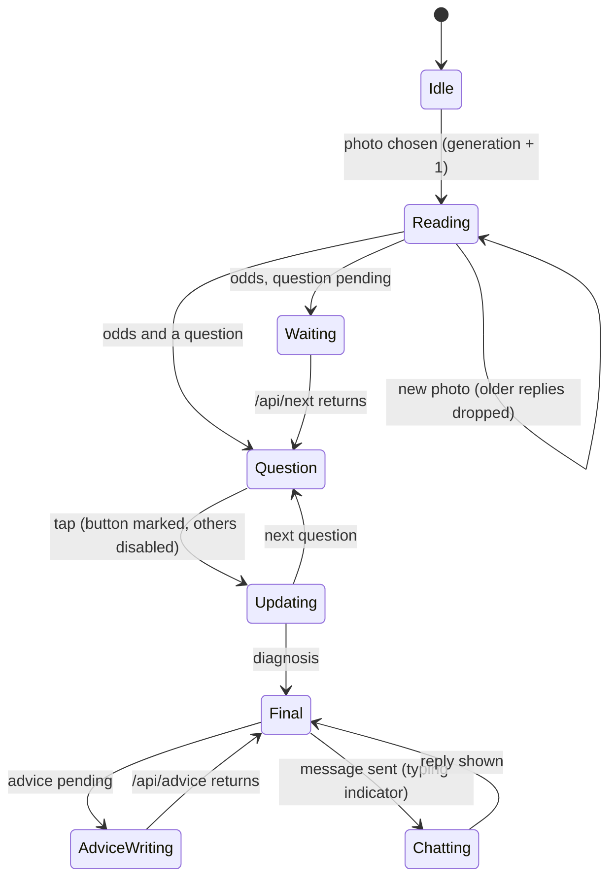

# Website

[Back to README](../../README.md) · Previous: [Live demo server](live-demo-server.md) · Start: [System overview](system.md)

`site/` is plain HTML, CSS and JavaScript with no framework and no build step. It is hosted as static files on Cloudflare Pages, published from the `site/` folder.

## Pages

## Live demo: on or off

The published site ships with the demo off; the server rewrites the tag when it serves the page itself.

## Client state and responsiveness

- Every request remembers the check generation it started in; a reply from an older check is dropped, so switching photos never mixes results.
- A tap marks the chosen button at once and disables the rest, then the bars animate to the new odds.
- If the server forgot the check (restart), the page re-sends the photo instead of showing an error.
- Every server string is escaped before it reaches the page.

Related: [Live demo server](live-demo-server.md), [System overview](system.md).
